# Diagrama de clases

El siguiente diagrama refleja las clases implementadas y las relaciones de
herencia, composición y dependencia principales.

```mermaid
classDiagram
    class Coordinate {
        +float lat
        +float lon
        +from_string(value) Coordinate
        +distance_to(other) float
        +as_tuple() tuple
    }

    class BoundingBox {
        +float south
        +float west
        +float north
        +float east
        +from_points(first, second, margin_m) BoundingBox
        +float width_m
        +float height_m
        +float area_km2
        +to_osmnx_tuple() tuple
        +cache_token(precision) str
    }

    class RouteResult {
        +tuple nodes
        +float distance_m
        +float duration_s
        +int nodes_expanded
        +str backend
        +str profile
        +str algorithm
        +float snap_origin_m
        +float snap_dest_m
        +tuple geometry
        +tuple warnings
        +float compute_time_s
        +distance_km() float
        +duration_min() float
    }

    class RoutingError
    class NoRouteFoundError
    class AreaTooLargeError
    class ProviderUnavailableError
    class SnapDistanceError

    class Settings {
        +str provider
        +str profile
        +str algorithm
        +float margin_m
        +float max_area_km2
        +float bike_speed_kmh
        +Path cache_dir
        +bool use_cache
        +str user_agent
        +from_env() Settings
    }

    class GraphCache {
        +Path directory
        +bool enabled
        +key(bbox, backend, profile, extra) str
        +load(key) MultiDiGraph
        +save(key, graph) None
        +clear() None
    }

    class GraphProvider {
        <<abstract>>
        +str name
        +load_graph(bbox, profile) MultiDiGraph
        +nearest_node(graph, coordinate) tuple
    }

    class OsmnxProvider {
        +load_graph(bbox, profile) MultiDiGraph
        +nearest_node(graph, coordinate) tuple
    }

    class OverpassProvider {
        +load_graph(bbox, profile) MultiDiGraph
        +nearest_node(graph, coordinate) tuple
    }

    class GraphProviderFactory {
        +create(name, cache, settings) GraphProvider
    }

    class CostProfile {
        <<abstract>>
        +str name
        +edge_cost(edge_data) float
        +heuristic_scale() float
    }

    class ShortestProfile {
        +edge_cost(edge_data) float
        +heuristic_scale() float
    }

    class BikeFriendlyProfile {
        +edge_cost(edge_data) float
        +heuristic_scale() float
    }

    class PathFinder {
        <<abstract>>
        +bind(graph, profile) PathFinder
        +find_path(origin, dest) PathSearchResult
    }

    class PathSearchResult {
        +tuple nodes
        +float cost
        +float distance_m
        +int nodes_expanded
        +float elapsed_s
        +str algorithm
    }

    class AStarPathFinder {
        +find_path(origin, dest) PathSearchResult
    }

    class DijkstraPathFinder {
        +find_path(origin, dest) PathSearchResult
    }

    class PathFinderFactory {
        +create(name) PathFinder
    }

    class RoutePlanner {
        +GraphProvider provider
        +CostProfile profile
        +PathFinder pathfinder
        +Settings settings
        +plan(origin, dest) RouteResult
    }

    class MapRenderer {
        +render(origin, dest, result, center, zoom) object
    }

    class StreamlitApp {
        +run() None
    }

    class CliApp {
        +run(argv) int
    }

    RoutingError <|-- NoRouteFoundError
    RoutingError <|-- AreaTooLargeError
    RoutingError <|-- ProviderUnavailableError
    RoutingError <|-- SnapDistanceError

    GraphProvider <|-- OsmnxProvider
    GraphProvider <|-- OverpassProvider
    CostProfile <|-- ShortestProfile
    CostProfile <|-- BikeFriendlyProfile
    PathFinder <|-- AStarPathFinder
    AStarPathFinder <|-- DijkstraPathFinder

    RoutePlanner o-- GraphProvider
    RoutePlanner o-- CostProfile
    RoutePlanner o-- PathFinder
    RoutePlanner o-- Settings
    RoutePlanner ..> RouteResult
    RoutePlanner ..> BoundingBox
    RoutePlanner ..> Coordinate

    GraphProvider o-- GraphCache
    OsmnxProvider ..> GraphCache
    OverpassProvider ..> GraphCache
    GraphProviderFactory ..> GraphProvider
    GraphProviderFactory ..> OsmnxProvider
    GraphProviderFactory ..> OverpassProvider

    PathFinderFactory ..> PathFinder
    PathFinderFactory ..> AStarPathFinder
    PathFinderFactory ..> DijkstraPathFinder
    PathFinder ..> CostProfile
    AStarPathFinder ..> PathSearchResult
    AStarPathFinder ..> CostProfile
    AStarPathFinder ..> Coordinate

    RouteResult *-- Coordinate
    RouteResult o-- BoundingBox
    Settings o-- Coordinate

    StreamlitApp o-- MapRenderer
    StreamlitApp ..> RoutePlanner
    CliApp ..> RoutePlanner
    MapRenderer ..> RouteResult
```

## Lectura rápida

- **Abstracción**: `GraphProvider`, `CostProfile` y `PathFinder` son clases
  abstractas (`abc.ABC`).
- **Herencia**: los proveedores, perfiles y buscadores concretos heredan de
  esas abstracciones. `DijkstraPathFinder` reutiliza el motor de
  `AStarPathFinder` cambiando solo la heurística.
- **Polimorfismo**: `RoutePlanner` llama a `load_graph`, `edge_cost` y
  `find_path` sin conocer las clases concretas.
- **Encapsulación**: atributos privados con propiedades y modelos de dominio
  `@dataclass(frozen=True)`.
- **Composición**: `RoutePlanner` recibe sus tres colaboradores por constructor;
  `GraphProvider` compone una `GraphCache` y `StreamlitApp` compone un
  `MapRenderer`.
